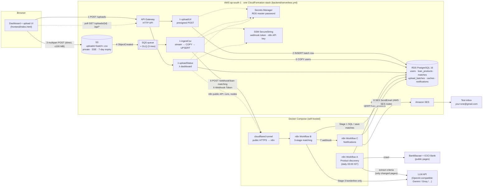
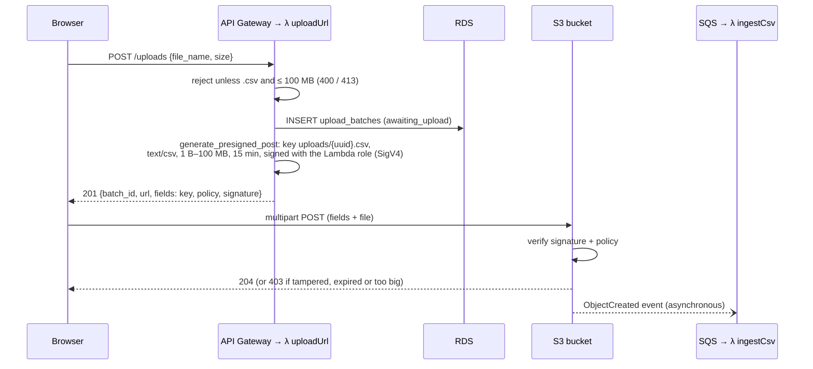

# Loan Eligibility Engine

An event-driven system that ingests user data from a CSV, crawls personal-loan products from public websites, matches users to the products they're likely eligible for, and emails them. It uses AWS serverless (S3, SQS, Lambda, RDS PostgreSQL, SES) together with a self-hosted **n8n** instance that runs all the business logic.

**Headline result (measured on AWS ap-south-1, 10,000-user sample CSV, 14 crawled products):**
- The matching pipeline cuts **140,000** possible user×product pairs down to **119** distinct LLM questions, answered in **5** batched LLM calls. A naive per-pair approach would need 140,000 calls.
- Upload to inbox takes **47 s**. On a re-upload all 119 verdicts come from the cache: **0** LLM calls, matching in **1.6 s**, upload to inbox in about **7 s**.
- The ingest Lambda loads the 10,000 rows in **2.2 s**.

---

## 1. Architecture



**Presigned upload, step by step**



**End-to-end flow**

1. The UI asks `POST /uploads` for a **presigned S3 POST** (it is size-capped and expires after 15 min). A row is created in `upload_batches`.
2. The browser uploads the file **straight to S3**. API Gateway and Lambda never see the bytes, so their 10 MB / 6 MB / 29 s limits don't apply.
3. S3 `ObjectCreated` → **SQS** → `ingestCsv` Lambda. SQS gives buffering, retries and a dead-letter queue.
4. The Lambda **streams** the CSV, validates each row, bulk-loads with **PostgreSQL `COPY`** into a temp table, and does one transactional `UPSERT` into `users`.
5. The Lambda calls the **n8n Workflow B** webhook with the `batch_id`. The call is authenticated with a shared-secret header.
6. Workflow B matches the batch, saves `matches` and funnel stats, then calls the **Workflow C** webhook.
7. Workflow C emails each matched user through the **AWS SES node** (Gmail SMTP is an optional fallback), sending to **test-inbox aliases only**.
8. The dashboard reads the pipeline through `GET /uploads/{id}` and `/api/*` (λ uploadStatus, λ dashboard), including live n8n runs node by node.

Workflow A runs on its own every day at 03:00 IST to keep `loan_products` fresh.

The UI shows each stage live (`awaiting_upload → ingesting → ingested → matching → matched → notified`) with timestamps, the matching funnel, and which n8n node is running.

---

## 2. Repository layout

```
backend/                     AWS side (Python 3.12, Serverless Framework v3)
  serverless.yml             S3, SQS+DLQ, 5 Lambdas, HTTP API, RDS, IAM (one CloudFormation stack)
  src/handlers/              upload_url · ingest · status · dashboard · migrate
  src/lib/                   config · db (pg8000) · csv_validation · ingest_core (COPY) · batches
                             n8n_client (webhook) · n8n_api (public API) · dashboard (read-only /api)
  db/schema.sql              all tables + status-history trigger (idempotent)
  db/seed_loan_products.sql  optional fallback if crawled sites are down during a demo
  tests/                     pytest: CSV validation, schema splitting
n8n/
  src/{A,B,C}_*/             the JS of every Code node and the SQL of every Postgres node, as real files
  build_workflows.py         assembles src/ into importable workflow JSON
  workflows/*.json           ← the 3 n8n workflows (generated; committed)
  init/                      auto-provisions credentials + imports + activates workflows on first start
docker-compose.yml           n8n + local Postgres (RDS stand-in) + optional Cloudflare tunnel
frontend/                    single-file operations dashboard + upload UI (no build step)
local/dev_server.py          runs the same Lambda code locally (stands in for API GW + S3 + SQS)
sample-data/users.csv        the provided 10k-user sample
docs/AWS_SETUP.md            detailed AWS runbook with checks and troubleshooting
```

---

## 3. Setup & deployment

### Prerequisites
Docker Desktop, Python 3.12+, Node 18+ and the AWS CLI v2 (only for deploying to AWS), and an LLM API key. Gemini (`gemini-3.5-flash-lite`) and Groq both have free tiers; without a key the matcher runs rules-only.

### 3.1 Configure

```bash
cp .env.example .env
# fill in: N8N_ENCRYPTION_KEY and N8N_WEBHOOK_TOKEN  (openssl rand -hex 24)
#          APP_DB_PASSWORD
#          AWS_ACCESS_KEY_ID / AWS_SECRET_ACCESS_KEY + SES_FROM_EMAIL      (AWS SES, default; see 3.5 step 1)
#          or EMAIL_USE_GMAIL=true + GMAIL_SMTP_USER / GMAIL_SMTP_APP_PASSWORD (Gmail fallback)
#          TEST_INBOX_ALIASES=you+one@gmail.com,you+two@gmail.com
#          LLM_API_KEY (+ LLM_BASE_URL / LLM_MODEL if not Gemini)
#          N8N_API_KEY=n8n_api_$(openssl rand -hex 24)                    (dashboard reads n8n runs)
```

### 3.2 Launch n8n (and a local Postgres)

```bash
docker compose up -d
```

On first start, the one-shot `n8n-init` container:

1. **creates the n8n credentials from `.env`** (details in 3.3).
2. imports workflows A, B and C and **activates** them.
3. provisions the dashboard's n8n API key (`N8N_API_KEY`) for the owner account.

Open http://localhost:5678 and create the owner account. The three workflows will be there and active. Then run `docker compose up -d --force-recreate n8n-init n8n` once more, so the API key is attached to the owner you just created.

### 3.3 Credentials in n8n (AWS and database)

**Automatic (default).** On every `docker compose up`, `n8n/init/make-credentials.js` builds the credentials from `.env` and imports them with **fixed IDs** that the workflow JSON already references, so no node needs re-selecting. n8n encrypts them at rest with `N8N_ENCRYPTION_KEY`; the repository contains only the IDs.

| n8n credential | Type | Built from `.env` | Used by |
|---|---|---|---|
| Loan Engine Postgres | Postgres | `N8N_DB_HOST`, `N8N_DB_PORT`, `N8N_DB_NAME`, `N8N_DB_USER`, `N8N_DB_PASSWORD`, `N8N_DB_SSL` | every Postgres node in A, B and C |
| Loan Engine AWS (SES) | AWS | `AWS_REGION`, `AWS_ACCESS_KEY_ID`, `AWS_SECRET_ACCESS_KEY` (the SES-only IAM user, 3.5 step 1) | *Send via AWS SES* (C) |
| Loan Engine Webhook Token | Header Auth | `N8N_WEBHOOK_TOKEN` → header `X-Webhook-Token` | webhook triggers of A, B and C |
| Loan Engine Gmail SMTP | SMTP | `GMAIL_SMTP_USER`, `GMAIL_SMTP_APP_PASSWORD` | Gmail fallback only (C) |

**Database credential: local vs AWS.**

```dotenv
# local Docker Postgres (default)
N8N_DB_HOST=app-db
N8N_DB_SSL=disable

# AWS RDS (after 3.5 step 3; password from Secrets Manager, see 3.5 step 4)
N8N_DB_HOST=loan-eligibility-engine-dev.xxxx.ap-south-1.rds.amazonaws.com
N8N_DB_PASSWORD='<password from Secrets Manager>'
N8N_DB_SSL=require
```

After changing any of these: `docker compose up -d --force-recreate n8n-init n8n`.

**Check:** in n8n open *Credentials → Loan Engine Postgres → Test*. It should report a successful connection.

**Manual alternative (n8n UI).**
1. *Credentials → Add credential → Postgres*: host = `app-db` or the RDS endpoint, database `loanengine`, user `loanadmin`, the password, SSL `require` for RDS (enable *Ignore SSL issues* or install the RDS CA). Click *Test*.
2. *Add credential → AWS*: region `ap-south-1`, the access key ID and secret of the IAM user that may only call `ses:SendEmail`.
3. *Add credential → Header Auth*: name `X-Webhook-Token`, value = `N8N_WEBHOOK_TOKEN`.
4. Open each workflow and select these credentials on the nodes n8n flags, then *Save* and *Activate*.

### 3.4 Run the pipeline locally (no AWS needed except SES)

This is the quick way to rehearse. For the real AWS deployment, go to 3.5.

```bash
python3 -m venv .venv && .venv/bin/pip install -r backend/requirements-dev.txt
.venv/bin/python local/dev_server.py          # → http://localhost:8000
```

1. In n8n, open **Workflow A** and click *Execute workflow*. This crawls the sites and fills `loan_products` (about 7 s).
2. Open http://localhost:8000, drop `sample-data/users.csv` in, and watch the stages and the funnel update live.
3. Check your inbox for `you+one@gmail.com`.

`local/dev_server.py` runs the **same handler code** as the Lambdas. It serves the presigned-POST contract and stands in for S3 → SQS by running `ingest.process_upload` in a background thread, so the UI and n8n can't tell the difference.

### 3.5 Deploy the AWS stack

All commands use region `ap-south-1` (Mumbai). Use the same region everywhere: SES, `.env` `AWS_REGION`, and deploy. [`docs/AWS_SETUP.md`](docs/AWS_SETUP.md) has the same steps with a check after each phase and a troubleshooting table.

**Step 1: AWS account, CLI, and SES (one-time, about 10 min)**

1. Create an IAM user for deploying (`loan-engine-deployer`, `AdministratorAccess`, used only by the CLI), make an access key, and run `aws configure` (region `ap-south-1`). Check with `aws sts get-caller-identity`. The account must not be blocked by an AWS Organizations SCP; a quick test is `aws ec2 describe-vpcs --region ap-south-1`.
2. Create an IAM user for n8n so it can send email. In *IAM → Users → Create user* (`loan-engine-n8n-ses`, no console access), attach an inline policy that allows `ses:SendEmail` and `ses:SendRawEmail` on `*`. Under *Security credentials*, create an access key and put it in `.env` as `AWS_ACCESS_KEY_ID` / `AWS_SECRET_ACCESS_KEY`.
3. In *SES (ap-south-1) → Identities → Create identity → Email address*, verify **`SES_FROM_EMAIL`, `you+one@gmail.com` and `you+two@gmail.com`**. In the SES sandbox, every recipient must be verified, and `+` aliases count as separate addresses. All the verification mails land in your one Gmail inbox, so click each link.
4. Leave `EMAIL_USE_GMAIL=false` in `.env`, so Workflow C uses the **AWS SES node**.

**Step 2: expose n8n so the ingest Lambda can call the Workflow B webhook**

```bash
docker compose --profile tunnel up -d
docker compose logs tunnel | grep -o 'https://[a-z0-9-]*\.trycloudflare\.com'
# put that URL in .env as N8N_PUBLIC_URL=https://<id>.trycloudflare.com/  then:
docker compose up -d n8n
```

The quick-tunnel URL changes whenever the tunnel container restarts. If that happens, redeploy with the new `N8N_MATCH_WEBHOOK_URL` (step 3, about 1 min).

**Step 3: deploy**

```bash
set -a; source .env; set +a                 # loads N8N_WEBHOOK_TOKEN etc. into the shell
cd backend && npm install
aws ssm put-parameter --region ap-south-1 --overwrite \
    --name /loan-engine/dev/n8n-webhook-token --type SecureString --value "$N8N_WEBHOOK_TOKEN"
aws ssm put-parameter --region ap-south-1 --overwrite \
    --name /loan-engine/dev/n8n-api-key --type SecureString --value "$N8N_API_KEY"   # dashboard → n8n API
export N8N_MATCH_WEBHOOK_URL=https://<id>.trycloudflare.com/webhook/loan-matching
npx serverless deploy --stage dev --region ap-south-1        # ~10 min the first time (RDS)
npx serverless invoke -f migrate --stage dev --region ap-south-1   # creates all tables
npx serverless info --stage dev --region ap-south-1 --verbose      # prints the API URL + DbEndpoint + DbSecretArn
```

The stack needs the account's **default VPC**. Every account has one unless it was deleted; if yours was, create it with `aws ec2 create-default-vpc`. Lambda IPs change, so `DB_ALLOWED_CIDR` stays `0.0.0.0/0`. Access is still gated by TLS and the Secrets Manager password (see 4.6).

**Step 4: point n8n at RDS**

```bash
aws secretsmanager get-secret-value --region ap-south-1 --secret-id <DbSecretArn> \
    --query SecretString --output text           # → {"username":"loanadmin","password":"..."}
```

In `.env`, set `N8N_DB_HOST=<DbEndpoint>`, `N8N_DB_PASSWORD=<password>` and `N8N_DB_SSL=require`, then run:

```bash
docker compose up -d --force-recreate n8n-init n8n
```

**Step 5: run it end to end**

1. Set `window.API_BASE = 'https://<id>.execute-api.ap-south-1.amazonaws.com'` in `frontend/config.js`.
2. Serve the dashboard: `python3 -m http.server 8080 --directory frontend`, then open http://localhost:8080 (not `file://`, which API Gateway CORS rejects).
3. Start **Workflow A** with *Run now* on the dashboard's Workflows tab (or *Execute workflow* in n8n). This fills `loan_products` in RDS.
4. Upload `sample-data/users.csv` in the UI. It goes through S3 → SQS → Lambda → RDS → Workflow B → Workflow C, and the email arrives at `you+one@gmail.com`.
5. To debug, run `npx serverless logs -f ingestCsv --stage dev --region ap-south-1`. In n8n, the *Executions* tab shows every run node by node.

**Tear down** (avoids charges): `npx serverless remove --stage dev --region ap-south-1`. No backups or snapshots are kept.

### 3.6 Email provider

Workflow C sends through the **AWS SES node** by default. Its IF node, **"Send via AWS SES?"**, reads `EMAIL_USE_GMAIL`:

* `false` (default) → **AWS SES**. Setup is in 3.5, step 1. The sandbox is fine because every recipient is a verified test alias.
* `true` → a **Gmail SMTP** fallback with an App Password (Google Account → Security → 2-Step Verification → *App passwords*).

After changing the flag or credentials: `docker compose up -d --force-recreate n8n-init n8n`.

### 3.7 Operations dashboard (`frontend/index.html`)

The UI is more than an upload form. It shows the whole pipeline live:

| Tab | What it shows | Data source |
|---|---|---|
| **Pipeline** | Upload a CSV. Watch the 7 steps (form → S3 → SQS + ingest → RDS → Workflow B → Workflow C → done), each with its timestamp. See Workflow B and C node by node as they run (click a node for its output), the matching funnel, the searchable matches table, emails and rejected rows. Click any user to see every match, its reason, and the SES message id. | `/api/batches/*`, `/api/users/*`, n8n executions |
| **Workflows (n8n)** | The three workflows, their triggers, which tables they touch, recent runs, and "open in n8n" links. Click a run to see each node's status, items, time and output. **Run now** starts Workflow A. | n8n public API |
| **Workflow A · Products** | What the crawler produced: `loan_products` (rates, criteria, LLM vs default source, matches per product), `crawl_cache` fingerprints, and the latest run. | `/api/products` |
| **Workflow C · Emails** | Every email sent: original CSV address (never emailed), test alias it went to, products, and SES MessageId. | `/api/notifications` |
| **Database** | Connection details (host, TLS, latency, server version), which components connect and how, and row counts per table with the component that writes it. | `/api/overview` |

The read-only `/api/...` endpoints live in `backend/src/lib/dashboard.py`. On AWS they're served by the `dashboard` Lambda; locally by `local/dev_server.py`. Workflow runs come from n8n's public REST API, using a key that `n8n-init` provisions from `N8N_API_KEY` (on AWS the key is stored in SSM as `/loan-engine/<stage>/n8n-api-key`). Step timestamps come from `upload_batches.status_history`, which a database trigger fills on every status change.

Open it **over HTTP**. API Gateway's CORS doesn't answer pages opened from `file://`:

```bash
python3 -m http.server 8080 --directory frontend     # AWS mode: frontend/config.js points at the API
# or locally: .venv/bin/python local/dev_server.py  → http://localhost:8000
```

---

## 4. Design decisions

### 4.0 Workflow design at a glance
Three rules shaped every workflow:
1. **Cheap work first.** SQL and plain JavaScript run before any LLM call; the LLM only sees what rules can't settle.
2. **Never trust one source.** Every scraped number passes sanity bounds; every LLM answer has a deterministic fallback and a stored reason.
3. **Safe to re-run.** Caches (`crawl_cache`, `llm_decision_cache`), upserts and idempotent steps make every workflow repeatable.

The workflows are decoupled through the database and authenticated webhooks: the ingest Lambda → **B** (`/webhook/loan-matching`), **B** → **C** (`/webhook/notify-users`), dashboard → **A** (`/webhook/crawl-products`), all with `X-Webhook-Token`. Every Code node's JS and every Postgres node's SQL lives as a real file in `n8n/src/`, and `build_workflows.py` assembles the importable JSON, so the logic is reviewable like normal code.

**How the LLM is used (only in two places):**

| | Workflow A · extraction | Workflow B · Stage 3 review |
|---|---|---|
| Called for | pages whose snippet hash changed | borderline profile buckets not already cached |
| Input | ~3 KB snippet of one page | 25 profile questions per call + the products' criteria |
| Prompt | "Return ONLY a JSON object with … use null when not stated" | "conservative credit analyst … answer ONLY with JSON `{id, eligible, reason}`" |
| Settings | temperature 0, one request per 4 s, 3 tries | temperature 0, one request per 4 s, ≤ `LLM_MAX_CALLS_PER_RUN` (20) |
| If it fails | cached extraction → regex heuristics → flagged defaults | `rules_fallback` (pair already passed every hard rule) |
| Measured on AWS | 6 calls on the first crawl, 0 on unchanged re-crawls | 5 calls for 10,000 users, 0 on the re-upload |

### 4.1 Ingestion: presigned upload + S3 → SQS → Lambda
- **Direct-to-S3 presigned POST.** S3 enforces `content-length-range` and `Content-Type` server-side, so a client can't swap in a bigger file. The upload limit is 100 MB, versus 6 MB through Lambda.
- **SQS in between.** It gives retries, a DLQ after 3 attempts, `ReportBatchItemFailures`, and smooths out bursts of uploads. `maximumConcurrency: 5` on the SQS trigger protects RDS from a connection storm (it caps pollers without reserving account concurrency, so it also works on new accounts limited to 10).
- **Streaming + `COPY`.** The CSV is never held in memory (`codecs.getreader` over the S3 stream). Rows are validated one at a time and copied in chunks of 5,000 into a temp table, followed by one `INSERT … ON CONFLICT` inside a single transaction. A batch is therefore all-or-nothing for the matcher, and re-uploading a user updates them (last write wins). **10,000 rows load in 2.2 s of Lambda time on AWS** (113 MB of 512 MB used).
- **Bad rows don't fail the file.** Each one is rejected with a reason (e.g. `line 17: credit_score out of range`), counted, and the first 20 are shown on the batch. Headers are forgiving: aliases such as `salary` or `CIBIL score` are accepted, as is an Excel BOM. Employment values are normalised to `salaried | self_employed | business`.
- **Idempotent.** SQS is at-least-once delivery, so a redelivered message for a batch that's already ingested does nothing.
- `pg8000` is a pure-Python driver, so there are no native wheels or Lambda layers. The DB password comes from **RDS-managed Secrets Manager**, the webhook token from **SSM SecureString**, and TLS to RDS is verified against the bundled RDS CA.

### 4.2 Workflow A: crawling strategy
- **Sites.** **BankBazaar**, an aggregator: one rate-comparison table gives about 13 lenders' rates and fees in a single request, and its per-lender pages hold the eligibility text. **ICICI Bank**, the lender's own eligibility page. Both are server-rendered, so plain HTTP works without a headless browser. Requests are polite: 1 per second, a descriptive User-Agent, and retries.
- **Snippet before LLM.** Pages are 200 KB to 1.2 MB of HTML. A Code node strips them to text, then keeps the windows around eligibility keywords that are densest in facts (₹ amounts, 3-digit scores, "21 years", %). That leaves about 3 KB, cutting tokens by roughly 98% and removing navigation noise.
- **Change detection.** A hash of each snippet is stored in `crawl_cache`. Unchanged pages **skip the LLM** and reuse the previous extraction. *Measured: the first crawl made 6 LLM calls; every later crawl of unchanged pages made 0.*
- **Layered extraction.** For each page, a fresh LLM answer beats the cached extraction, which beats regex heuristics. Across sources for the same lender, the official site beats the aggregator. Sanity bounds reject absurd values (e.g. a "0%–6%" processing fee misread as an interest rate). With **no LLM key**, the regex layer alone still pulls real criteria: HDFC ₹25k and age 21–60, ICICI score 700, Kotak salaried-only.
- Lenders that only appear in the rate table get conservative defaults (₹25k, 750, 21–60) with `criteria_source='default'`, and the matcher down-weights them. Products not seen for 7 days are deactivated. Everything is written in **one bulk SQL statement** (`jsonb_to_recordset`), not one query per product.

### 4.3 Workflow B: the Optimization Treasure Hunt

A multi-stage funnel where every stage is cheaper than the one after it and shrinks that stage's input:

| Stage | Where | What it does | Sample CSV (10k users × 14 products) |
|---|---|---|---|
| 0 | – | every possible pair | **140,000** |
| 1 · SQL pre-filter | PostgreSQL | All hard criteria (income ≥ min, score range, age range, employment ∈ allowed) are **JOIN predicates** in one query. The cross-product never leaves the database. Pairs come back as compact arrays in **one** n8n item, not 44k items, which avoids n8n's per-item overhead. | **44,196** |
| 2 · Rules & ranking | n8n Code (O(n) JS) | Score 0–100 from credit headroom, income headroom and best rate. **FOIR affordability check** (EMI ≤ 50% of income for a ₹50k loan over 60 months at the product's worst rate). Keep **top-K = 5 per user**. Split into **clear** pairs (accepted without the LLM) and **borderline** pairs (within 20 points of the score cut-off, within 10% of the income cut-off, or at the edge of the age range). | **20,758** kept → 13,601 clear / 7,157 borderline |
| 3a · Profile bucketing | n8n Code | Borderline pairs are collapsed into **buckets**: product × employment × *only the dimensions that are actually borderline* (a score-borderline user is bucketed by 10-point score band, with income recorded as just "comfortably above minimum"). Users in the same bucket get the same answer. | **119 unique questions** |
| 3b · Verdict cache | PostgreSQL | `llm_decision_cache` keyed by bucket. Persists across batches and uploads. | 2nd upload: **119 / 119 cache hits** |
| 3c · Batched LLM | HTTP → LLM | 25 questions per prompt. The prompt includes the lender's qualitative `other_criteria` (e.g. "2 years work experience", "salaried at MNCs"). There's a hard per-run budget (`LLM_MAX_CALLS_PER_RUN`), and requests are spaced 4 s apart for free-tier rate limits. | **5 calls** (1st run), **0** on the re-upload |

Behaviour that keeps the funnel safe:
- **Fails safe.** If the LLM is down, over budget, or not configured, borderline pairs fall back to the rules verdict (`decision_source='rules_fallback'`), because they already passed the hard criteria. A failure in the LLM stage never means "no matches".
- **Traceable.** Every match records `decision_source` (`rules` / `llm` / `llm_cache` / `rules_fallback`) and a human-readable `reason`. The `reason` is shown in the email.
- **Measured.** The full funnel is written to `upload_batches.match_stats` and drawn in the UI after each upload.
- **n8n gotcha handled.** A branch that receives zero items stops in n8n. The "plan" nodes therefore always emit at least one item (`{skip:true}`), and the IF node routes to either the LLM path or straight to *Assemble*, so *Assemble* runs exactly once either way.
- Re-uploaded users have **stale un-notified matches pruned** in the same SQL statement that saves the new matches.

### 4.4 Workflow C: notifications
- Workflow B calls C through a webhook when it finishes. One query returns each pending user with all their products already aggregated as JSON.
- **Pluggable provider.** An IF node (*Send via AWS SES?*) routes to the **AWS SES node** by default, or to a **Gmail SMTP** fallback when `EMAIL_USE_GMAIL=true`. Both branches feed the same result collector, so logging and `notified_at` stamping are identical.
- One HTML email per user lists every match, with rate, a "why you match" reason and a link.
- **Recipient safety.** Recipients are **always rewritten** to `TEST_INBOX_ALIASES` (round-robin). If no aliases are set, the workflow **throws instead of emailing real addresses**. `NOTIFY_MAX_EMAILS` caps each run.
- Only emails SES accepted are logged in `notifications` and have their matches stamped `notified_at`. Failures stay pending, and the batch shows `notify_failed` with the SES error in the UI.

### 4.5 Dashboard
- A read-only `/api` (λ dashboard) serves batches, matches, users, products, emails and DB health, and proxies n8n's public API so the UI can show which workflow and node is running. Completed n8n runs are summarised (status, time, items, a compact output preview per node) and cached, because a full Workflow B execution is about 8 MB.
- Step timestamps come from `upload_batches.status_history`, filled by a database trigger, so every component (Lambda or n8n) is timed without extra code.

### 4.6 n8n ↔ AWS integration and security (IAM)

| Identity | Can | Cannot |
|---|---|---|
| Lambda execution role | `s3:PutObject/GetObject` on `uploads/*` only · read **one** secret · read **two** SSM parameters · consume **one** queue · write its own logs | list buckets, read other secrets, send email |
| `loan-engine-n8n-ses` (IAM user in n8n) | `ses:SendEmail`, `ses:SendRawEmail` | anything else in AWS |
| Browser | upload one exact key for 15 minutes through the presigned policy | any other S3 access |
| `loan-engine-deployer` | administer the stack (CLI only) | (not used at runtime) |

- Webhooks use **Header Auth** with a shared secret. Lambda reads the secret from SSM at runtime.
- The RDS master password is generated by RDS into **Secrets Manager** and fetched at runtime; it is never in code or Lambda env vars. TLS to RDS is verified against the bundled RDS CA.
- n8n credentials are created from env vars and encrypted at rest by n8n. The workflow JSON contains only credential IDs.
- **Trade-off (documented on purpose).** The Lambdas run outside a VPC and RDS is `PubliclyAccessible` behind a security group (`DB_ALLOWED_CIDR`) with TLS enforced. Putting the Lambdas in a VPC would need a NAT Gateway (about $32/month) just so they could reach the n8n webhook, and the brief asks to avoid cloud cost. For production: Lambda in private subnets, a NAT or VPC endpoint, RDS private, and n8n reaching RDS through a VPN or bastion. The code wouldn't need to change, only `serverless.yml`.

### 4.7 Scaling notes
- Ingestion is bounded by Lambda's 15 minutes. At about 10k rows/s that is millions of rows. Beyond that, S3 Select or Step Functions could fan out by byte range.
- Stage 1 can be paged by `user_id` range if a batch ever outgrows a single n8n item. Stage 3's cost grows with the number of **distinct profiles**, not the number of users.

---

## 5. Tunables (`.env`)

| Variable | Default | Effect |
|---|---|---|
| `MAX_MATCHES_PER_USER` | 5 | top-K per user (Stage 2) |
| `LLM_MAX_CALLS_PER_RUN` | 20 | hard LLM budget per matching run (Stage 3) |
| `LLM_BASE_URL` / `LLM_MODEL` / `LLM_API_KEY` | Gemini | any OpenAI-compatible endpoint; leave the key empty to run rules-only |
| `NOTIFY_MAX_EMAILS` | 3 | emails per run (SES sandbox / demo safety) |
| `EMAIL_USE_GMAIL` | false | `false` = AWS SES node, `true` = Gmail SMTP fallback |
| `TEST_INBOX_ALIASES` | – | **required** for Workflow C |

## 6. Developing the workflows

Edit the JS/SQL in `n8n/src/`, then:

```bash
python3 n8n/build_workflows.py && docker compose up -d --force-recreate n8n-init n8n
```

If you edit a workflow in the n8n UI instead, export it with *Download* and copy any Code-node changes back into `n8n/src/`. Unit tests: `cd backend && ../.venv/bin/python -m pytest`.

## 7. Known limitations
- Crawled criteria are only as good as the public pages. Lenders publish ranges, and the system keeps the lowest stated minimum.
- The CSV has no existing-EMI or work-experience fields, so FOIR assumes no existing obligations, and experience-type criteria are left to the LLM's qualitative judgement.
- The dashboard API is unauthenticated (it serves sample data for the demo). In production, put it behind an API Gateway JWT/IAM authorizer.
